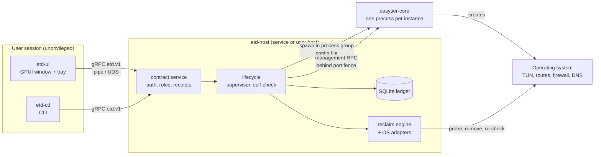

<h1 align="center">EasyTier Desktop</h1>

<p align="center">
  A desktop client for the <a href="https://github.com/EasyTier/EasyTier">EasyTier</a>
  mesh VPN that keeps the UI unprivileged and cleans up after every kernel exit.
</p>

<p align="center">
  <a href="docs/architecture/README.md">Architecture</a> ·
  <a href="docs/development/README.md">Development standards</a> ·
  <a href="CONTRIBUTING.md">Contributing</a> ·
  <a href="https://github.com/greenhat616/easytier-desktop/issues">Report an issue</a>
</p>

<p align="center">
  <a href="https://github.com/greenhat616/easytier-desktop/actions/workflows/ci.yml">
    
  </a>
  <a href="LICENSE">
    
  </a>
  <a href="rust-toolchain.toml">
    
  </a>
  
</p>

EasyTier Desktop runs the upstream `easytier-core` kernel for you on Windows, Linux and
macOS. The window and the command line never touch the kernel or the operating system
directly: they talk to a small host process over a versioned, authenticated local
contract. The host starts each network instance, writes down every system change the
kernel is expected to make before it starts, and removes those changes again after a
normal stop, a kernel crash, a host crash or a power cut.

> [!WARNING]
> EasyTier Desktop is in early development and has **no release yet**. The trusted
> kernel table (`crates/etd-host/cores.lock`) in the repository is empty, so a build from
> source cannot start a kernel until release packaging supplies one. Interfaces, on-disk
> formats and the UI are still changing. Do not use it to manage networks you depend
> on.

## Features

What exists in the code today:

- **UI and host split.** The GPUI desktop app (`etd-ui`) and the CLI (`etd-ctl`) are
  plain clients of `etd-host`. Neither has a dependency path to EasyTier; CI enforces
  this.
- **Versioned local contract.** gRPC (`etd.v1`) over a named pipe or Unix domain
  socket, with a version handshake, capability flags, per-method roles (read, control,
  admin) and peer credentials taken from the operating system. No shared secrets or
  token files.
- **Two host forms.** An installable system service (SCM, systemd, launchd) that keeps
  networks up without a logged-in user, and a per-user host started by the UI for
  networks without TUN.
- **Ledger before action.** Every predicted side effect (TUN adapter, firewall rules,
  registry values, DNS settings, the runtime directory, the kernel process) is
  committed to a SQLite ledger in the same transaction as the request and the new
  desired state, before the kernel is launched.
- **One reclaim path.** Whether the kernel stopped, crashed or the machine lost power,
  the host probes, removes and re-checks the recorded objects, and deletes an object
  only when its creation credentials or an exclusive container prove it is ours.
  Anything it cannot prove is reported as a candidate for the user to confirm.
- **Fenced kernel management port.** The kernel's unauthenticated loopback RPC port is
  closed to everyone but the host (Windows WFP, Linux nftables, macOS PF) and the fence
  is verified in both directions before management pages are enabled.
- **Idempotent requests.** Every change carries a client request id and an expected
  revision; a lost reply is recovered from the host instead of being re-applied.
- **Trusted kernel bundles.** The host runs only kernel binaries whose SHA-256 hashes
  were embedded from `cores.lock` at build time; clients cannot choose a kernel path.
- **Desktop UI.** Instance list and editor, node, route and traffic pages when the host
  offers them, a reclaim report with per-item confirmation, an in-app offer to install
  the service, tray integration, and a Fluent theme (light, dark or follow the system;
  accent colour and Mica backdrop on Windows).
- **Scriptable CLI.** `etd-ctl status | apply | start | stop | logs | reclaim-report`
  with `--json` output and documented exit codes.

Planned, not implemented: the Windows elevated session host (one UAC prompt per
session, no service), installer packages, the simple "game lobby" mode, and further
EasyTier options that need contract extensions.

## Platform support

| | Windows | Linux | macOS |
| --- | --- | --- | --- |
| Desktop UI and tray | Yes | Yes (X11; tray through StatusNotifierItem) | Yes |
| User host (no TUN) | Yes | Yes | Yes |
| System service host | Yes (SCM) | Yes (systemd) | Yes (launchd) |
| Kernel port fence | WFP | nftables, by uid | PF, by user |
| Magic DNS | One instance at a time | systemd-resolved | Disabled in the first release |
| Elevated session host | Planned | No | No |
| Installer package | Planned (MSI) | Planned (deb, rpm, Arch) | Not planned yet |

Privileged behaviour on each platform is covered by CI jobs on disposable runners; see
[Testing](docs/testing/README.md).

## Architecture



The UI only ever changes the desired state. The host pulls the actual state towards it,
and every kernel exit goes through reclaim before the next generation may start. See
the [architecture overview](docs/architecture/README.md) for the processes, crates,
channels and state machines.

## Build from source

Prerequisites:

- [rustup](https://rustup.rs). `rust-toolchain.toml` pins Rust 1.100.0 with rustfmt
  and Clippy.
- `protoc` 36.2 on `PATH`.
- A platform C/C++ toolchain: MSVC and the Windows SDK on Windows, Xcode Command Line
  Tools on macOS, and on Linux the native build, graphics and windowing libraries GPUI
  needs (the `check` job in [`.github/workflows/ci.yml`](.github/workflows/ci.yml)
  lists the Debian packages).

```sh
cargo build --workspace --locked
cargo run -p etd-ui                       # desktop app
cargo run -p etd-host -- run --mode user  # a user host in the foreground
cargo run -p etd-ctl -- --host user status
```

Checks that CI runs on every push:

```sh
cargo fmt --all -- --check
cargo xtask check-boundaries
cargo clippy --locked --workspace -- -D warnings
cargo nextest run --locked --workspace --profile ci
cargo test --locked --workspace --doc
cargo deny --locked check
```

`cargo-nextest` and `cargo-deny` are separate installs. Privileged tests are marked
`#[ignore]` and run only in CI or disposable VMs; never run them on your own desktop.
See [Development workflow](docs/development/workflow.md) for the details.

## Project layout

```text
crates/
  etd-contract       etd.v1 Protobuf contract, generated messages, role table
  etd-ipc            named pipes / Unix sockets, peer identity, tonic transport
  etd-client         HostClient trait and gRPC client (UI and CLI side)
  etd-app            UI logic without GPUI: state store, bridge, exit gate, tray state
  etd-ui             GPUI desktop app (binary)
  etd-ctl            command-line client (binary)
  etd-host           host composition root, install and maintenance commands (binary)
  etd-host-core      host orchestration and contract service, traits only
  etd-proc           process engine over ProcessKit, identity, restart policy
  etd-sysfx          side-effect model, SQLite ledger, reclaim engine
  etd-sysfx-os       Windows / Linux / macOS adapters, service installation
  etd-core-api       kernel adapter traits, independent of EasyTier
  etd-core-easytier  EasyTier adapter: launch plans, effect prediction, management RPC
  etd-testkit        fakes, conformance suites, fake-core, integration tiers (test-only)
xtask/               cargo xtask: architecture boundary check and repository tests
docs/                architecture, development standards, testing
skills/etd-ctl/      agent skill for operating a host with etd-ctl
```

Each crate has a README describing its surface, boundaries and tests.

## Contributing

Bug reports and pull requests are welcome. Read [CONTRIBUTING.md](CONTRIBUTING.md) and
the [development standards](docs/development/README.md) first. Coding agents follow
[AGENTS.md](AGENTS.md).

## Acknowledgements

- [EasyTier](https://github.com/EasyTier/EasyTier), the mesh VPN this client manages.
  The adapter links its `easytier-proto` and `easytier-core` crates at a pinned
  revision.
- [ProcessKit](https://crates.io/crates/processkit), for process groups and job
  objects.
- [GPUI Kit](https://crates.io/crates/gpui-kit), [tray-icon and
  muda](https://github.com/tauri-apps/tray-icon), for the desktop UI.
- [tonic](https://github.com/hyperium/tonic) and
  [prost](https://github.com/tokio-rs/prost), for the local contract.
- [Fluent UI System Icons](https://github.com/microsoft/fluentui-system-icons) (MIT).
- [Clash Nyanpasu](https://github.com/libnyanpasu/clash-nyanpasu), whose process
  identity and quarantine approach the host builds on.

## License

Licensed under [LGPL-3.0-or-later](LICENSE). [COPYING-GPL-3.0](COPYING-GPL-3.0) holds
the GPL version 3 text that the LGPL refers to. Third-party components keep their own
licenses.
