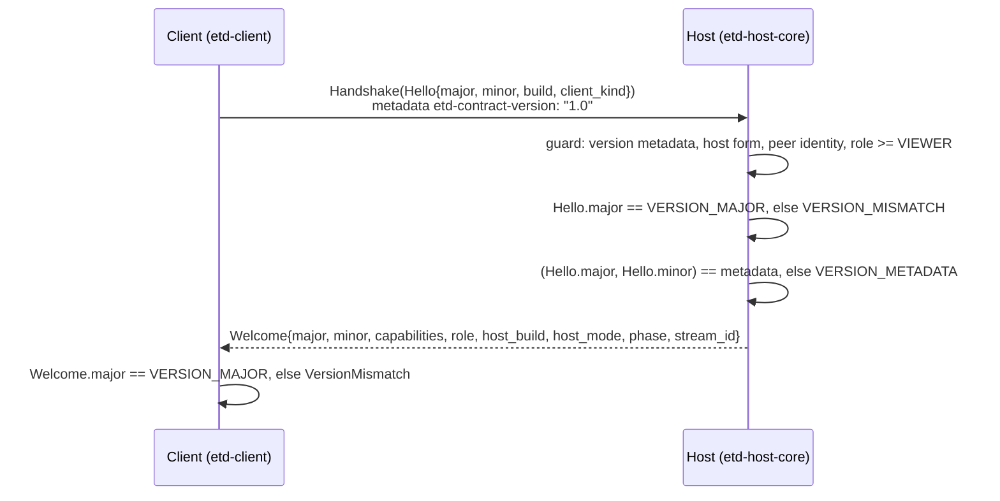

# Versioning and negotiation of `etd.v1`

This document explains how the desktop contract evolves and how a client and a host agree
on what they can do together. The sources are `proto/etd/v1/*.proto` and `src/*.rs` in
this crate, the root `buf.yaml`, the handshake and guard in `etd-host-core`
(`src/negotiate.rs`, `src/service/mod.rs`, `src/auth/`), and the client side in
[`etd-client`](../../etd-client/README.md).

## Version numbers

| Constant | Value | Rule |
| --- | --- | --- |
| `VERSION_MAJOR` | `1` | Must match exactly between client and host |
| `VERSION_MINOR` | `0` | Minor versions only add; nobody compares it |

The Protobuf package name carries the major version (`etd.v1`). A major version is
needed for any change that an existing peer could misread: removing, renumbering,
retyping or renaming a field, enum value, message or method, or changing a method's
streaming shape or required role.

These changes are compatible and go into a new minor version:

- new fields, messages and enum values;
- new methods (each with a `(etd.v1.required_role)` option);
- new capability names.

The wire format makes these changes safe. A newer reader of an older writer sees
absent fields as their defaults. An older reader of a newer writer skips unknown
fields, and keeps an unknown enum value as its raw number while the typed accessor
reports `*_UNSPECIFIED`. `tests/wire_compat.rs` checks all of this for every message.

Clients must never turn a feature on because of a version number. They switch on
capability names (below).

## Handshake

Every new connection starts with `Handshake(Hello) -> Welcome`. `etd-client` builds a
new session for every connection, so server verification and the handshake always
run again together after a reconnect, and the capabilities, role and stream id are
renegotiated.



`Hello` fields: `major`, `minor`, `build` (informational), `client_kind`
(`CLIENT_KIND_DESKTOP` or `CLIENT_KIND_CLI`).

`Welcome` fields: the host's `major` and `minor`, its `capabilities`, the caller's
`role` (derived from its OS credentials), `host_build`, `host_mode` (service, elevated
session or user), the host `phase` (self-check, serving, diagnostic-only, shutting
down) and the `stream_id` that is part of every `EventCursor` of this host run.

On a major mismatch the host answers with `ERROR_CODE_VERSION_MISMATCH` and fills
`ErrorDetail.host_major` / `host_minor`. `etd-client` also refuses a `Welcome` that
carries a foreign major. In both cases it reports `CallError::VersionMismatch`, sets
`ConnectionState::UpgradeRequired` (the UI shows "upgrade the service") and keeps
retrying with backoff in case the host is upgraded. The minor version is never
compared on either side.

## Capabilities

The host lists the features it offers in `Welcome.capabilities`. The names are
constants in `etd_contract::capability`. Later minor versions may add names; clients
must ignore names they do not know. `etd-client` refuses a call whose capability is
missing before sending it (`CallError::Unsupported`).

| Name | Calls it opens (as gated by `etd-client`) |
| --- | --- |
| `instances` | `Snapshot`, `Subscribe`, `Apply`, `SetDesired`, `RemoveInstance`, `GetReceipt`, `RetryStart` |
| `query.nodes` | `Query` with `QUERY_KIND_NODES` |
| `query.routes` | `Query` with `QUERY_KIND_ROUTES` |
| `query.traffic` | `Query` with `QUERY_KIND_TRAFFIC` |
| `logs` | `StreamLogs` |
| `reclaim` | `GetReclaimReport`, `RetryReclaim` |
| `reclaim.candidates` | `ResolveCandidates` |
| `lease` | `ReleaseLease` (session-form hosts) |
| `admin.allow_list` | `GetAllowList`, `SetAllowList` |
| `admin.cores` | `ListCores`, `SelectCore` |
| `admin.purge` | `PurgeAllData` |
| `tun` | No call; TUN instances are possible on this host |

`Handshake` needs no capability.

The capabilities offered by `etd-host` depend on its form:

- Both forms: `instances`, `logs`, `reclaim`, `reclaim.candidates`, `admin.cores`,
  `admin.purge`, `query.nodes`, `query.routes`, `query.traffic`.
- Service host: also `tun` and `admin.allow_list`.
- User host: also `lease`.

The handshake handler filters again: a user host never lists `tun` or
`admin.allow_list`, and a service host never lists `lease`.

## Per-call version metadata

Every call, not only the handshake, carries the gRPC metadata entry

```text
etd-contract-version: <major>.<minor>
```

(`VERSION_METADATA_KEY`, value from `version_metadata_value()`). On the client side,
`etd-client` adds it to every request with a tonic interceptor.

On the host side, `etd_host_core::negotiate::check_version` accepts the call only if
the metadata contains exactly one such entry, the value parses as `<u32>.<u32>`, and
the major equals `VERSION_MAJOR`:

| Problem | Error code | gRPC code |
| --- | --- | --- |
| Entry missing, repeated, or not `<major>.<minor>` | `ERROR_CODE_VERSION_METADATA` | `INVALID_ARGUMENT` |
| Major differs | `ERROR_CODE_VERSION_MISMATCH` (with `host_major`, `host_minor`) | `FAILED_PRECONDITION` |

`ContractService` runs this check first in the guard of every handler, unary and
streaming, so a bare generated server or a direct call cannot skip it.
`negotiate::VersionInterceptor` runs the same check at the tonic transport boundary,
before Protobuf decoding. The production `etd-host` relies on the handler check only;
the interceptor is used in the `etd-host-core` tests.

## Roles

`options.proto` declares the method option

```protobuf
extend google.protobuf.MethodOptions {
  Role required_role = 50000;
}
```

and every method of `HostService` carries it. `etd_contract::method_roles()` and
`required_role("/etd.v1.HostService/<Method>")` read the table from the compiled
descriptor, so the `.proto` file is the only source. A method without the option
yields `None`, and the host rejects calls to it (`PERMISSION_DENIED`, "Method has no
role"). `tests/roles.rs` ensures no method lacks the option.

Roles are ordered: `ROLE_ADMIN` may call everything `ROLE_CONTROL` may call, and
`ROLE_CONTROL` everything `ROLE_VIEWER` may call.

| Role | Methods |
| --- | --- |
| `ROLE_VIEWER` | `Handshake`, `Snapshot`, `Subscribe`, `GetReceipt`, `Query`, `StreamLogs`, `GetReclaimReport`, `ListCores` |
| `ROLE_CONTROL` | `Apply`, `SetDesired`, `RemoveInstance`, `RetryReclaim`, `RetryStart`, `ReleaseLease` |
| `ROLE_ADMIN` | `ResolveCandidates`, `GetAllowList`, `SetAllowList`, `SelectCore`, `PurgeAllData` |

The host guard checks, in this order:

1. The version metadata (above).
2. The host form. The elevated-session form is not implemented: every call to such a
   host fails with `ERROR_CODE_FEATURE_REJECTED`.
3. The peer identity. The listener in `etd-ipc` attaches it from the OS (Windows
   token, Unix peer credentials). If it is missing, the call fails with
   `PERMISSION_DENIED`.
4. The caller's role, from `AllowListAuthorizer`:
   - User host: the account that owns the host gets `ROLE_ADMIN`; nobody else gets a
     role.
   - Service host: the highest role among the allow-list entries that match the
     peer's user or any of its groups (Windows SIDs, Unix uid/gid). A matched
     `ROLE_ADMIN` is lowered to `ROLE_CONTROL` unless the peer is elevated (Windows
     elevated token, Unix uid 0).
   - No matching entry: `PERMISSION_DENIED`.
5. The method's required role. A caller below it gets `PERMISSION_DENIED`. The one
   exception is a `ROLE_CONTROL` caller of a `ROLE_ADMIN` method on a service host
   whose token is not elevated: it gets `ERROR_CODE_ELEVATION_REQUIRED`.

`Handshake` itself requires `ROLE_VIEWER`, so a peer without a role cannot complete
it.

## Errors

A rejected call returns a gRPC status whose details hold an encoded `ErrorDetail`
(`code`, `message`, and depending on the code `current_revision`, `features`,
`instance_id`, `host_major`, `host_minor`). The host maps codes to gRPC status codes as
follows:

| `ErrorCode` | gRPC code |
| --- | --- |
| `PERMISSION_DENIED`, `ELEVATION_REQUIRED` | `PERMISSION_DENIED` |
| `REVISION_CONFLICT` | `ABORTED` |
| `UNKNOWN_INSTANCE`, `UNKNOWN_CANDIDATE` | `NOT_FOUND` |
| `INVALID_SPEC`, `REQUEST_ID_REUSED`, `VERSION_METADATA` | `INVALID_ARGUMENT` |
| `LEDGER_UNAVAILABLE` | `UNAVAILABLE` |
| every other code | `FAILED_PRECONDITION` |

Clients should decide on the `ErrorDetail`, not on the gRPC code. `etd-client` treats
any status that carries a detail as a definite answer from the host. A status without
one (`UNAVAILABLE`, `UNKNOWN`, `INTERNAL`, `CANCELLED`, `ABORTED`, `DEADLINE_EXCEEDED`)
means the transport failed and the outcome is unknown.

## Idempotent mutations

Every state-changing request carries a `MutationHeader`: `Apply`, `SetDesired`,
`RemoveInstance`, `RetryReclaim`, `RetryStart`, `ResolveCandidates`, `SetAllowList`,
`SelectCore` and `PurgeAllData`. `ReleaseLease` has no header.

```protobuf
message MutationHeader {
  string request_id = 1;        // client-generated, reused verbatim on retry
  uint64 expected_revision = 2; // the revision the client last observed
}
```

The host handles mutations one at a time. For each one it:

1. Checks that the request id is 1 to 256 bytes long, else `INVALID_SPEC`.
2. Computes a digest over the method, the authenticated caller, the expected revision,
   the canonically re-encoded request, and a per-installation key.
3. Looks up the request id in the ledger:
   - The same id with the same digest is already committed: the host returns the
     original receipt, even if the revision has moved on since.
   - The same id with a different digest: `ERROR_CODE_REQUEST_ID_REUSED`.
   - An unknown id: the host continues.
4. Refuses the request if it is not in `HOST_PHASE_SERVING`
   (`ERROR_CODE_HOST_NOT_SERVING`).
5. Compares `expected_revision` with the current ledger revision. If they differ, it
   answers `ERROR_CODE_REVISION_CONFLICT` with `ErrorDetail.current_revision`.
6. Commits the request record, the desired state, the new revision and an operation
   ticket in one ledger transaction. When the request starts a new generation of an
   instance, the same transaction also holds that generation's reserved epoch and
   planned side effects. Only after the commit does the host answer.

The `Receipt` (`request_id`, `revision`, `ticket`, `accepted_unix_ms`) means only
"durably accepted". Progress is reported on the event stream: `DesiredChanged` carries
the `request_id` and `ticket`.

A retry is recognised only if the request id, the expected revision and the content
are all unchanged, because the caller and the revision are part of the digest.
`etd-client`'s `new_request_id()` produces a UUID v4.

### Lost replies and `GetReceipt`

`GetReceipt(request_id)` returns the receipt of an earlier mutation, or no receipt if
the host has no record of that id. It requires `ROLE_VIEWER`. Callers below
`ROLE_ADMIN` only see receipts of their own requests.

The two clients in this repository recover lost replies differently:

- `etd-client` (`GrpcHostClient`): when a mutation's reply is lost (timeout, or a
  transport failure without `ErrorDetail`), the client waits up to
  `ClientOptions::recovery_timeout` for a connection and looks the receipt up with
  `GetReceipt`. It never re-sends the mutation. If no receipt is found, the caller
  gets the original `Unavailable` / `Transport` error and the outcome stays unknown.
- `etd-ctl` additionally re-sends the identical request (same id, revision and
  content) up to two more times. The host answers a re-send of a committed request
  with its original receipt.

## Descriptor baseline

`tests/baseline/etd.v1.txt` is a sorted text rendering of the compiled descriptor of
package `etd.v1`. It has one line per file, message, field (number, label, type, oneof),
enum value, extension, RPC (streaming shape, input and output types) and method role,
for example:

```text
field .etd.v1.MutationHeader.request_id = 1 single TYPE_STRING
rpc .etd.v1.HostService.Subscribe(.etd.v1.SubscribeRequest) returns (stream .etd.v1.Event)
role /etd.v1.HostService/Apply = Some(Control)
```

`tests/descriptor.rs::descriptor_matches_baseline` compares the current descriptor
with the file:

- A line that is in the baseline but no longer produced fails as
  `BREAKING: baseline entries changed or removed (needs a major version)`.
- A new line fails as an additive change that needs review.

After reviewing an additive change, regenerate the file and commit it with the
change:

```sh
ETD_UPDATE_BASELINE=1 cargo nextest run -p etd-contract
```

With the variable set, the test rewrites the file instead of comparing it.

## `buf lint` and `buf breaking`

The root `buf.yaml` (version `v2`) declares the module `crates/etd-contract/proto` and
configures:

- `lint`: the `STANDARD` rules, except `RPC_REQUEST_STANDARD_NAME` and
  `RPC_RESPONSE_STANDARD_NAME`, because `Hello` / `Welcome` are intentional handshake
  names;
- `breaking`: the `FILE` rule category.

Run both from the repository root:

```sh
buf lint
buf breaking --against '.git#tag=freeze-v1'
```

`buf` is an extra tool that the repository does not install, and the CI workflows in
this tree do not run it. The descriptor baseline test is the check that runs in CI
(through `cargo nextest run --workspace`).

## Changing the contract

The crate is a frozen interface: a change goes through a reviewed change request, not
an incidental edit. A compatible change:

1. adds fields, values, messages or methods with fresh numbers, and a
   `(etd.v1.required_role)` option on each new method;
2. adds a capability constant when clients need to detect the feature, and makes the
   host list it;
3. adds new messages to the `all_messages!` list in `tests/wire_compat.rs` (the
   `every_contract_message_is_covered` test enforces this) and updates
   `tests/roles.rs` for new methods;
4. regenerates the baseline with `ETD_UPDATE_BASELINE=1`, and passes `buf lint` and
   `buf breaking --against '.git#tag=freeze-v1'`.
