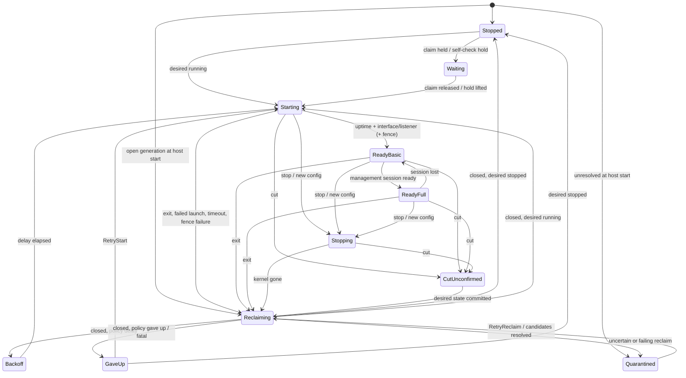

# Instance lifecycle in etd-host-core

This document describes how the host core runs kernel instances: the orchestrator
actor, the per-instance supervisor and its state machine, generations, the startup
self-check, the management-port fence and the poll rate. It follows the code in
`src/lifecycle/`, `src/supervisor.rs`, `src/boot.rs`, `src/fence_seq.rs` and
`src/poller.rs`. Ledger and reclaim engine semantics live in `etd-sysfx`; see
[docs/architecture/side-effects.md](../../../docs/architecture/side-effects.md).

## Actors

- **Orchestrator actor** (`lifecycle::Orchestrator`, `lifecycle/mod.rs`). One task.
  It runs the self-check, answers the contract service's `api::Command`s in order,
  executes accepted ledger tickets oldest first, and starts one supervisor per
  configured instance. It is the only publisher (`lifecycle::view::Publisher`), so
  event sequence numbers have no gaps.
- **Supervisor** (`supervisor::Supervisor`). One task per instance. It owns the
  kernel process of the instance's live generation and moves the instance along the
  edges in `lifecycle::machine::EDGES`. An edge not in the table is refused and
  logged (a debug assertion in tests).

A ticket reaches a supervisor as `SupCmd::Desire`, carrying the committed desired
state as it is now (never the ticket's own copy), the generation the ticket reserved
(if any) and whether it was a `RetryStart`. A replayed ticket therefore cannot revive
a stop that was already receipted, or an older configuration.

## Generations and epochs

Every start is a new **generation** `(instance, epoch)`. The epoch comes from the
ledger (`next_epoch`). `lifecycle::plan::plan_generation` produces the generation's
full list of effects (the kernel's predicted system effects plus the host's own:
runtime directory `run/<instance>/<epoch>/`, process record, fence rule) and its
launch inputs. It is persisted before anything happens, either in the same
transaction as a client mutation (a ticket's generation) or by the supervisor itself
through `Ledger::begin_epoch` (restart, deferred start, deny-all re-plan).

- **Reclaim before restart.** `begin_epoch` refuses while an earlier generation of the
  instance is open (`EpochOpen`); the supervisor then reclaims that one first. Every
  exit, requested or not, is followed by `ReclaimEngine::reclaim_generation`, and the
  restart delay starts only once the generation is closed. An open generation never
  coexists with a new one.
- **Replay.** A generation is launched only from its persisted inputs:
  `plan::replay` re-verifies the kernel hash, re-runs the pure launch plan and
  requires the stored effects. A mismatch is fatal for that generation.
- Status messages, exit events and log lines carry the epoch.

## States

| State | Meaning |
| --- | --- |
| `STOPPED` | Desired state stopped (or the instance was removed); no open generation. |
| `WAITING` | A start is deferred: a single-writer resource is held by another instance, or the self-check has not accounted for every kernel yet. |
| `STARTING` | Generation reserved; fence, spawn, read-back of kernel objects, readiness checks. |
| `READY_BASIC` | Kernel alive long enough and its interface or listener observed by the OS (plus a verified fence, if fenced). No management RPC needed. |
| `READY_FULL` | The kernel's management session answered and is being polled. |
| `STOPPING` | Graceful stop, tree kill after the grace period. |
| `RECLAIMING` | The generation's records are being reclaimed (probe, remove, re-check). |
| `BACKOFF` | Waiting for the restart delay (or a retry after a transient ledger error). |
| `GAVE_UP` | Circuit breaker open, or the start is refused for a reason that will not go away. Desired state stays running. |
| `QUARANTINED` | The process tree, or a record, could not be confirmed gone. Never restarted, never reclaimed automatically. |
| `CUT_UNCONFIRMED` | A stop could not be committed; the kernel was killed anyway and nothing is reclaimed until a desired state commits. |

`Unspecified` is the state of a supervisor that has not published yet. The live states
(`machine::is_live`) are `STARTING`, `READY_BASIC`, `READY_FULL`, `STOPPING`.

The diagram shows the main paths; `machine::EDGES` is the complete list (for example
`Backoff`, `GaveUp` and `Waiting` can also move to `Reclaiming`, `Waiting` or
`CutUnconfirmed`). The table's invariants are unit-tested in `lifecycle/machine.rs`:
a live state is left only through `STOPPING`, `RECLAIMING` or `CUT_UNCONFIRMED`;
`STARTING` is reached only from states without a live kernel; `QUARANTINED` is left
only through `RECLAIMING`.

## What triggers each transition

### Starting a generation (`Supervisor::try_start`, `launch`, `prepare_and_spawn`)

The supervisor starts when desired state is running and it is neither given up nor
waiting. In order:

1. Self-check hold active: `WAITING` with the hold reason.
2. A ticket's generation that is still open is launched directly (closed if a stop
   was committed meanwhile). Otherwise a new epoch is planned and reserved with
   `begin_epoch`:
   - transient ledger error: `BACKOFF` and retry after `reclaim_retry`;
   - planning refused (no kernel, feature rejected, missing prerequisite such as
     `/dev/net/tun`), `InvalidPlan`, exhausted counter, no configuration: `GAVE_UP`;
   - `ExclusiveTaken`: `WAITING`, with a notice naming the holder;
   - `EpochOpen`: `RECLAIMING` the open generation first;
   - `EpochNotNext`: nothing; the ticket that reserved the epoch brings it.
3. `STARTING`, then before the spawn: replay; check that the derived interface name
   is not held by a foreign object (if it is: reclaim, then `QUARANTINED`); re-read
   desired state (superseded: reclaim, then settle); kernel objects that already
   exist under a key this generation would read back are marked as conflicts for the
   administrator, never claimed; an unreadable baseline blocks the start.
4. Fence installed (fenced generations only). Failure: reclaim, then re-plan with
   deny-all (see below).
5. Runtime directory created, generated files written read-only, record applied.
6. Desired state re-read once more, then `ProcessEngine::spawn`, and the identity
   (pid, start token, containment) written to the process record at once. If that
   write fails the kernel is killed; an uncertain kill quarantines.

Spawn outcomes: exit before identity capture counts as an abnormal exit; cleanup
uncertainty quarantines; any other spawn error counts as abnormal.

### While live (`Supervisor::live_tick`)

Ticks run every `readiness_tick` (250 ms) while starting, then at the poll deadline.

- Kernel records still `Planned` are read back until their creation credential is
  observed (a record without a credential is never deleted by name alone).
- **Basic readiness:** uptime at least the plan's `minimum_uptime`, a verified fence
  if fenced, and the plan's readiness condition (`InterfaceAddress`,
  `OwnedInterfaceAddress` or a `Listener` owned by the kernel PID). Not reached within
  `start_timeout` (60 s): the kernel is killed and the exit counts as abnormal.
- **Full readiness:** only with a verified fence or an unguarded (user host)
  generation. An unguarded attach first checks that the management port's listener
  is the kernel's PID. `CoreDriver::attach` plus `wait_ready` (`full_ready_timeout`,
  10 s) moves to `READY_FULL`; a failure retries after 1 s. A failed poll drops the
  session: back to `READY_BASIC`, re-attach after 1 s.
- Generations with guard `LifecycleOnly` or `DenyAll` never attach; queries answer
  `MANAGEMENT_UNAVAILABLE`.

### Exits and stops

- `ProcessEvent::Exited`: an abnormal exit (`ExitCause::Exited`) asks the restart
  policy; a requested one settles. Either way: `RECLAIMING`.
- `ProcessEvent::CleanupUncertain`, or an event channel that closes without a
  terminal event and no exit within `stop_grace`: the generation's process records
  are moved to `Quarantined` in the ledger, then `RECLAIMING` -> `QUARANTINED`.
- Desired state stopped, instance removed, or a changed kernel-relevant configuration
  while live: `STOPPING`, graceful stop for `stop_grace` (10 s), then tree kill,
  then `RECLAIMING`.

### Reclaim and what follows (`Supervisor::reclaim`, `closed`)

`RECLAIMING` waits while the self-check hold is active. The reclaim engine's outcome:

- error or residues remain: stay `RECLAIMING`, retry every `reclaim_retry` (2 s);
- quarantined: `QUARANTINED`;
- closed: follow the pending decision. Backoff: `BACKOFF` until the delay. Gave up:
  `GAVE_UP` with notice `instance.gave_up`. Fence fallback: next plan uses deny-all.
  Quarantine (foreign interface name): `QUARANTINED`. Otherwise follow desired state
  (`STOPPED` or a new `STARTING`).

### Backoff and the circuit breaker

The policy comes from `HostDeps::restart_policy` (`etd_proc::backoff::BackoffPolicy`
in the product): delays 1 s, 2 s, 4 s, 8 s for abnormal exits within a rolling five
minutes; the fifth gives up. `GAVE_UP` keeps desired state running. Only
`RetryStart` (resets the policy, the attempt counter and the fence-failure flag) or a
committed stop leaves it. Abnormal exits include start timeouts, spawn failures and
exits before identity capture.

### Quarantine

Entered when a process tree or a record cannot be confirmed gone: cleanup
uncertainty, an uncertain kill, a quarantining reclaim, an unkillable orphan found by
the self-check, or a foreign object on the derived interface name. Left only by:

- `RetryReclaim`: first kills kernels of this instance that no open record knows
  (marker sweep of `run/<instance>/`), then re-admits the instance to automatic
  reclaim and runs `ReclaimEngine::retry`;
- `ResolveCandidates` (administrator decisions): the generation is reclaimed again.

### Cut, unconfirmed

When committing a stop fails because the ledger is unavailable, the service sends
`Command::Cut`. Cutting traffic does not depend on the ledger: a live kernel is killed
at once (no graceful stop), and the instance shows `CUT_UNCONFIRMED`, with the
message that a host restart may undo the stop. Nothing is reclaimed. The next
committed desired state moves it to `RECLAIMING` (or `STOPPED` if no generation was
open). A cut during `STOPPING` interrupts the graceful stop.

### Waiting

`WAITING` clears when another generation closes (`SupCmd::ClaimsChanged`), after
candidates are resolved, on a new desired state, or when the self-check hold is
lifted.

## Startup self-check (`boot.rs`)

The phase is `SELF_CHECK`; only presence and log requests are served meanwhile.

1. The singleton lock is already held: the composition root takes it before the
   orchestrator exists.
2. Boot ID and desired state are read. A ledger schema that is newer or unreadable
   gives **diagnose-only**: orphan kernels are listed, not killed, and
   `ReclaimEngine::diagnose` reports without deleting. An otherwise unavailable
   ledger: an orphan sweep runs; exclusive containers are cleaned
   (`recover_without_ledger`) only if every kernel found was killed. Both end in the
   `DIAGNOSTIC_ONLY` phase with no instance started.
3. **Orphan kernels.** Every open process record with a recorded identity is checked
   (a record from an earlier boot that closes on reboot is left to the reclaim
   engine, unprobed). `Gone`/`Reused`: left to the engine. `Same`: verified kill.
   `Uncertain` or a failed kill: the record is quarantined in the ledger, and so is
   its instance. Then a marker sweep per `run/<instance>/<epoch>/` kills kernels no
   record knows (a crash between spawn and recording the PID); an unkillable one
   quarantines that instance. A final sweep of the whole run directory catches the
   rest.
4. `ReclaimEngine::reclaim_all(Instances)`: every open generation, process record
   first; one failing generation does not stop the others.
5. The reclaim report is published and closed records are compacted.
6. `SERVING`: one supervisor per desired instance, starting from its open records
   (quarantined, or a pending generation to reclaim), then pending tickets replay.

Nothing is reclaimed without proof that no kernel of ours can still use it:

- process records unreadable, a sweep failing, or an unkillable kernel that cannot be
  attributed to an instance sets a **hold**: step 4 is skipped, starts show `WAITING`,
  reclaims wait, and `boot::resweep` retries every `reclaim_retry` until it succeeds;
- a quarantine that cannot be persisted (closed generation, ledger refusing the write)
  is kept in memory: that instance's generations and the exclusive-container sweep are
  left out of automatic reclaim (and of `PurgeAll`) until a `RetryReclaim` proves no
  kernel of it is alive.

Running the self-check twice writes nothing the second time.

## Management-port fence (`fence_seq.rs`)

Used only by privileged hosts with a kernel adapter profile and a platform fence
(`plan::choose_guard`). The fence record is part of the generation.

1. Before the spawn, `fence_seq::install` puts the rule in place and marks the
   record applied. Failure means no spawn.
2. On each tick after the spawn, `fence_seq::check` requires that the listener on the
   management address belongs to the PID just spawned; nothing listening yet (or an
   unreadable observation) is `Pending`.
3. Both directions are probed (`PortFence::verify`) against that live listener. A
   refusal on an empty port proves nothing and stays `Pending`.
4. Any mismatch is `Failed`: the supervisor kills the kernel and reclaims, and the
   next generation is planned with `ManagementGuard::DenyAll`. The kernel driver
   accepts deny-all only when the adapter profile marks it verified; otherwise no
   privileged instance starts.
5. The rule ranks after the process record, so the reclaim engine removes it only
   once the kernel is verified dead. The orchestrator never removes it itself.

Basic readiness of a fenced generation waits for `Verified`; the management session
is opened only after it.

Guards by host form: user host with profile `Unguarded`, without profile
`LifecycleOnly`; privileged host `Fence`, or `DenyAll` after a fence failure or
without a platform fence; privileged host without profile: refused.

## Poll rate (`poller.rs`)

EasyTier has no streaming RPC, so the supervisor polls the management session of a
fully ready instance and turns kernel events into contract events.

- 1 s (`SUBSCRIBED_INTERVAL`) while at least one client subscribes to events; 30 s
  (`HEALTH_CHECK_INTERVAL`) otherwise, where a successful poll is the health check.
- The first round is one period after the session became ready; each round re-arms
  from its own end.
- On a presence change the period is recomputed from the last round: a new
  subscriber is served within a second (immediately if that time has passed), a
  departing one stretches the wait to 30 s after the last round.

## Timing defaults (`LifecycleConfig`)

| Field | Default |
| --- | --- |
| `stop_grace` | 10 s |
| `readiness_tick` | 250 ms |
| `start_timeout` | 60 s |
| `full_ready_timeout` | 10 s |
| `reclaim_retry` | 2 s |
| `log_lines` | 1000 per instance |
| `lease_grace` | 30 s |
