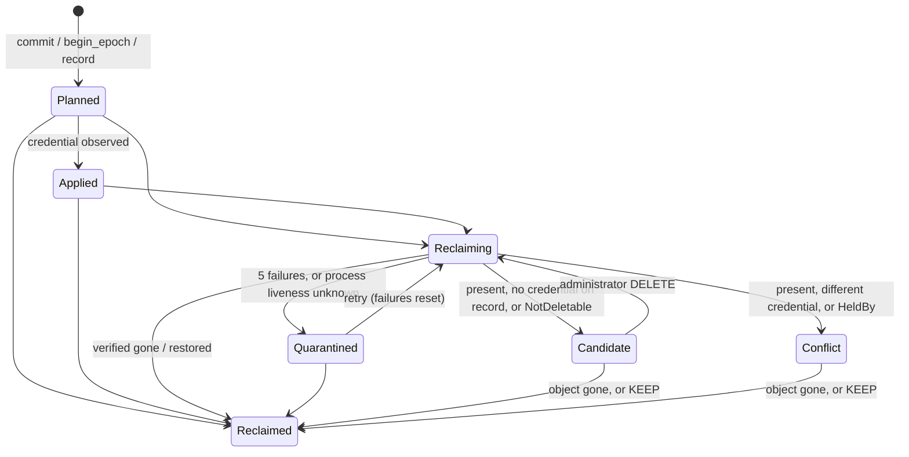

# Ledger and reclaim

How `etd-sysfx` records system side effects and takes them back. Everything here is
implemented in `src/model.rs`, `src/ledger.rs`, `src/sqlite/` and `src/engine/`; the
platform side is in [`etd-sysfx-os`](../../etd-sysfx-os/docs/platforms.md). For the
workspace-level picture see
[docs/architecture/side-effects.md](../../../docs/architecture/side-effects.md).

## Effect records

An `EffectIntent` is what a planner wants recorded before it acts. The ledger turns it
into an `Effect` with an id, state `Planned`, the current boot id and a timestamp.

| Field | Meaning |
| --- | --- |
| `id` | Ledger-assigned, opaque, sortable by creation (SQLite: zero-padded decimal) |
| `scope` | `Instance { instance, epoch }` (one generation), `Product` (driver, service; only purge or uninstall), or `CoreBinary { sha256 }` (Windows program firewall rules shared by every instance launched from one kernel binary) |
| `kind` | `EffectKind`; its stable string (`win.tun`, `linux.fence_rule`, ...) is stored and reported. One reclaimer per kind |
| `key` | `ObjectKey`: what is known before the action (path, interface name and GUID, rule name, registry value, fence container + rule + port, ...). Locates only |
| `undo` | `EnsureAbsent` (objects), `RestoreIfOurs { ours, original }` (settings), `ReplayUpstreamRecovery` (Windows Magic DNS) |
| `persistence` | `WithProcess`, `UntilReboot`, `Persistent`, `Expiring { until }`, `Lease { seconds }` |
| `state` | See the state machine below |
| `boot` | Boot id when the record was written |
| `observation` | Latest `Observation`: credential and concrete key read back after the action (pid + start token, LUID + device instance id, interface index + boot id, file id, rule GUID, exclusive container), or what a probe saw |
| `failures`, `last_error` | Consecutive reclaim failures |

Facts that exist only after the action (a pid, a system-assigned `utunN`, a
router-assigned port) are recorded later as the observation's credential and concrete
key; the planned key never changes.

`Lease` is the planned form of a router mapping whose absolute end is unknown: it
expires `seconds` after the generation's process is gone. `Lease` and `Expiring`
records are record-only (see below).

## Record states

Only `Reclaimed` is closed. A generation stays open while any of its records is open,
and a new epoch of the instance cannot start while an older one is open. These are the
transitions the SQLite state machine allows (`sqlite/state.rs`); any other is
`InvalidTransition`. Moving to `Reclaimed`, or out of `Quarantined`, resets the failure
counter.

## One commit, one transaction

`Ledger::commit(expected, ChangeSet)` persists in one SQLite transaction:

1. the request record (request id, caller, SHA-256 digest of the canonical request);
2. the changes: `PutInstance` (spec with secret, desired state, single-writer claims),
   `SetDesired`, `RemoveInstance`, `RetryReclaim`, `RetryStart`, `ResolveCandidates`,
   `SetAllowList`, `SelectCore`, `PurgeAll`;
3. the new revision (`expected + 1`);
4. the operation ticket (SQLite names it `ticket-<revision>`), replayed after a restart until marked done;
5. every generation the mutation starts: epoch reservation, persisted `LaunchInputs`,
   immutable claims, and all planned effect intents.

Rules, checked inside the transaction against committed state:

- **Idempotency first.** A known request id with the same digest returns the original
  receipt even after state has moved on; with a different digest it is
  `RequestReused`. Callers use `request_status` before any planning.
- `expected` must equal the current revision, else `Conflict { current }`.
- A generation's epoch must be exactly `high-water + 1` (`EpochNotNext`); no older
  generation of the instance may be open (`EpochOpen`); the instance must exist, not be
  pending removal, and be desired `Running`; its `spec_revision` and spec must equal
  the committed configuration; it must contain a generation-scoped `Process` intent;
  every instance-scoped intent must belong to that generation (`InvalidPlan`).
- Product and core-binary intents are recorded once per kind + key: an open record
  with the same scope, kind and key is reused.
- Claims: two instances desired `Running` may not share a desired claim, and a
  generation may not start while another instance holds any of its claims, through
  its configuration or through an open generation (`ExclusiveTaken`). A committed stop
  or a replaced configuration does not release a generation's claims; only closing the
  generation does.
- `begin_epoch` (supervisor restarts without a client request) applies the same
  generation checks; `record` adds one more planned effect to an open generation.

`RemoveInstance` sets desired `Stopped`; the configuration is dropped at once if no
generation is open, otherwise when the last record closes (the revision advances then
as well). `PurgeAll` removes every instance the same way, clears the selected kernel
(the allow-list is kept) and the request history.

Epoch high-water marks never go down and survive `compact`. `compact` drops closed
generations with their records (a generation with any open record is kept whole for
replay) and completed receipts that are both outside the newest 1000 and older than 7
days.

## SQLite storage

- One dedicated thread owns the only connection. Each mutation is applied to a copy of
  the state, persisted, and published only after the transaction committed; after an
  ambiguous failure the state is reloaded from disk.
- `journal_mode=WAL`, `synchronous=FULL`, `secure_delete=ON`, `fullfsync` on macOS,
  2 s busy timeout. Payloads are versioned JSON in typed rows; counters are decimal
  `TEXT`.
- `PRAGMA user_version` is the schema version (currently 1). A newer version is
  `SchemaTooNew` and data this version cannot interpret is `Unreadable`; both leave the
  file untouched and put the host into diagnose-only mode. Storage faults (disk full,
  read-only, locked, corrupt, I/O) are `Unavailable` and refuse new commits.
- Completed tickets are scrubbed of their changes on open (they may contain old
  secrets). A pending purge forces a `wal_checkpoint(TRUNCATE)` so deleted rows also
  leave the WAL.

## Reclaim engine

`ReclaimEngineImpl` runs one entry point at a time. For each group of records (one
generation, or the ready product / core-binary records):

1. **Record-only first out.** `Lease` and `Expiring` records never take part in the
   order, never block and are never reclaimed actively; they close with a note giving
   the expected expiry.
2. **Reboot.** If the current boot id differs from the record's, `WithProcess` and
   `UntilReboot` records close without a probe. If the boot id cannot be read, nothing
   is closed unprobed.
3. **Process first.** The kernel process records are handled before anything else.
   Until every one of them is closed (killed and verified gone, or absent), no other
   record of the group is touched: a live kernel would fight or recreate its objects.
   A process probe that cannot tell quarantines the record at once.
4. **Rank by rank,** lowest first, ties by record id:

   | Rank | Kinds |
   | --- | --- |
   | 10 | firewall rules, NRPT, systemd-resolved link, UPnP, Windows Magic DNS recovery |
   | 20 | Windows registry values, network-list profile |
   | 30 | TUN / wintun / utun interface |
   | 35 | routes |
   | 40 | runtime directory |
   | 50 | process |
   | 60 | fences (last, after the kernel is verified dead) |
   | 90 | product scope (driver, service registration) |

   A rank with a record still ours and not gone (pending, failing, quarantined,
   indeterminate) stops the higher ranks; candidates and conflicts do not block.

Per record: move to `Reclaiming`, probe, decide, act, verify.

| Probe result | Decision |
| --- | --- |
| absent | close |
| indeterminate | count a failure (never treated as absent) |
| present, `RestoreIfOurs` | reclaimer restores `original` only while the value is still `ours`, else `LeftModified`; equal values mean nothing to undo |
| present, `ReplayUpstreamRecovery` | reclaimer checks its own gate; key must probe absent afterwards |
| present in an exclusive container | delete |
| present, credential equals the recorded one | delete |
| present, different credential | `Conflict` (never deleted) |
| present, record has a credential, probe read none | failure (indeterminate) |
| present, record never got a credential | `Candidate` (never deleted automatically) |

After a delete the object must probe absent, otherwise it is a failure. A reclaimer's
`CredentialMismatch` becomes a conflict, and so does `HeldBy(holder)`: a positive proof
that another owner holds the object now, named in a report note. `HeldBy` counts only on
the record's first attempt: the engine marks a record `Reclaiming` durably before calling
its reclaimer, so a record already `Reclaiming` when the run starts may have been changed
part-way by an earlier run (one that crashed included), and `HeldBy` is then a failure. `NotDeletable(reason)`
(ours, but that reclaimer never deletes it, such as a live wintun adapter) makes the record
a candidate; an administrator's DELETE meets the same answer and leaves it a candidate
with a note. Neither counts as a failure; both are re-probed on every run and close once
the object is gone. An unprovable holder is `Busy`, a failure. At `QUARANTINE_AFTER` (5) consecutive failures
the record is quarantined; `retry` moves quarantined records back to `Reclaiming` and
runs the instance's open generations again. A held record stores the credential it saw
only in the observation detail, so nothing it saw can later authorise a delete.

### Entry points

- `reclaim_generation`: one generation after its process exited.
- `reclaim_all(Instances | Everything)`: every open generation, oldest epoch first; with
  `Everything` also product records (only once no instance generation is open) and
  core-binary records (only once no open generation uses that binary). Then a sweep.
- `reclaim_core(sha256)`: before a kernel leaves the store; refused with `EpochOpen`
  while an open generation launched from it.
- `resolve(decisions)`: administrator decisions. `KEEP` closes a candidate or conflict
  (the object stays). `DELETE` applies to candidates only, waits for the same gates as
  automatic reclaim, and only if a fresh probe shows the same key and credential as
  reported; that credential is handed to the reclaimer for this one call and never
  persisted. A candidate id encodes the reported identity, so a refreshed candidate
  needs a new decision.
- `recover_without_ledger`: ledger unavailable but not newer: clean exclusive
  containers only, list the rest as candidates.
- `diagnose`: ledger newer or unreadable: sweep and list, never call a reclaimer.

### Sweep and repair index

The platform `Sweeper` finds product-marked objects outside the ledger. Objects an
open record already locates are skipped; interface names and GUIDs match without
regard to ASCII case. On Windows so do service names (the service control manager
may report another case than the planned key), registry key paths and value names (the
plan spells an adapter GUID in upper case, the sweep reports it as enumerated), firewall
and NRPT rule names and groups, and network profile names, as the Windows observer
matches them. Other keys, and every key on other platforms, match exactly. Objects in an exclusive container (WFP
sublayer, nftables table, PF anchor, host-owned runtime root) are removed, but only
once no kernel process record is open. Everything else is a candidate: names
re-derived from the repair index (`FoundBy::DerivedName`) or a bare `etd-` prefix
(`PrefixOnly`). Swept candidates and KEEP decisions on them live in memory only; a
restart sweeps again.

The repair index is the single out-of-ledger file: the install key and the instance
ids. It lets the sweep re-derive interface names after ledger loss. It never starts an
instance and never authorises a deletion.
