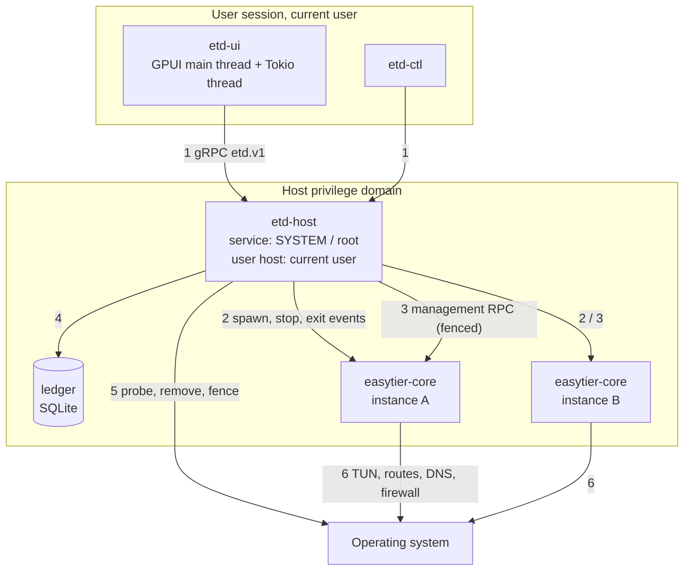
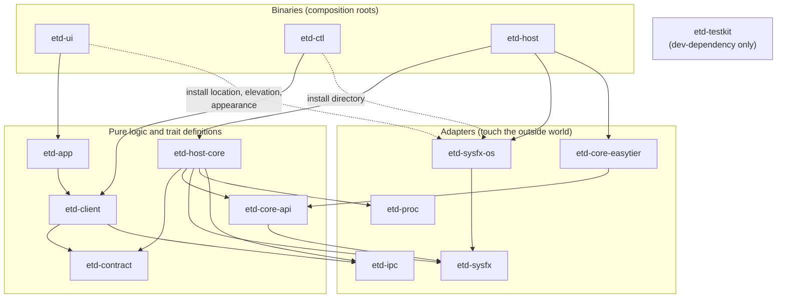
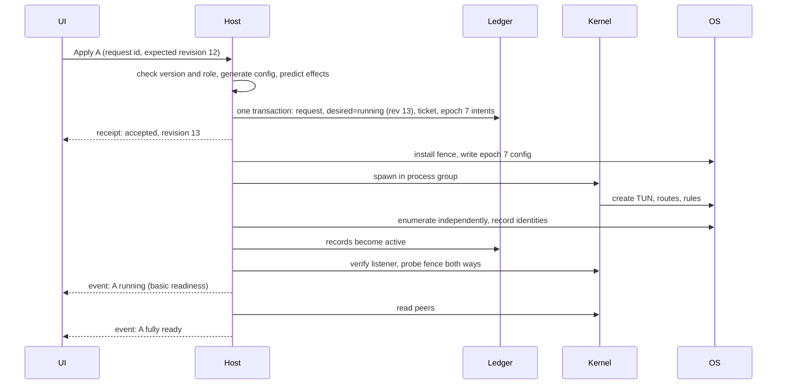

# Architecture overview

EasyTier Desktop puts a host process, `etd-host`, between the user interface and the
EasyTier kernel. The UI and CLI speak only our own versioned contract to the host. The
host alone starts and stops kernel processes, records the system changes they make,
and removes those changes again. A normal stop, a killed kernel, a crashed host and a
power cut all end in the same reclaim path: probe, remove, re-check.

This page is the map. Details live in:

- [Host](host.md): host forms, authentication, instance and host lifecycles, exit
  scenarios, the kernel port fence.
- [Side effects](side-effects.md): what a kernel leaves behind, the ledger, ownership
  proofs and reclaim.
- Crate READMEs under [`crates/`](../../crates) and their local `docs/`.

## Goals

1. The UI is never privileged and never depends on EasyTier. A UI bug cannot reach
   system privileges, and an upstream protocol change touches one crate.
2. Nothing the kernel does to the system is forgotten. Effects are recorded before the
   kernel can make them, and reclaimed after every exit, whatever the cause.
3. Nothing that is not ours is deleted. A name is only a way to find an object;
   deletion needs proof of ownership, otherwise the object is reported to the user.
4. Several kernel versions and several users on one machine are possible, because the
   host pairs each kernel version with an exact adapter profile and authenticates every
   caller with operating-system credentials.

## Processes and privileges



The UI is always just a client. If it crashes, networking is unaffected and a new UI
restores everything from the host's snapshot. If the host dies, its kernels die with
it (job object, systemd cgroup, process group) and the next host start-up reclaims what
they left behind.

`etd-host` is one binary with these forms; the contract and authorisation are the same
for all of them:

| Form | Started by | Runs as | Can do | Status |
| --- | --- | --- | --- | --- |
| System service | SCM, systemd or launchd, at boot | SYSTEM / root | Everything, including TUN | Implemented |
| User host | The UI, as a child process | Current user | Instances without TUN (SOCKS5, port forwarding) | Implemented |
| Elevated session | The UI, through one UAC prompt | Elevated administrator | Everything, including TUN, while the UI holds a lease | Planned, Windows only |

See [Host forms](host.md#host-forms).

## Crates and dependency direction



Dependencies point down; real implementations plug in from the side. The UI and CLI
use `etd-sysfx-os` only for read-only queries (where the service is installed, whether
the process is elevated, the desktop appearance). To install the service, the UI runs
`etd-host install` with the platform's elevation prompt; it never changes the system
itself. `etd-host-core`
sees only traits (`ProcessEngine`, `Ledger`, `ReclaimEngine`, `PortFence`,
`SystemObserver`, `CoreDriver`, `Authorizer`, `CoreStore`, ...). `etd-host` assembles
the real implementations; tests assemble fakes from `etd-testkit`. There is no
dependency path from the UI side to EasyTier.

CI enforces these rules with `cargo xtask check-boundaries`
([rules](../development/workflow.md#architecture-boundaries)):

1. The closure of `etd-ui`, `etd-app` and `etd-client` contains no `etd-core-easytier`
   and no `easytier*` crate.
2. Only `etd-proc` uses ProcessKit; system binding crates appear only in
   `etd-sysfx-os`, `etd-ipc` and `etd-proc`.
3. `etd-host-core` depends on trait crates only, so its tests never compile EasyTier
   or need real processes.

## Channels

| # | Between | Transport | Authentication | Carries |
| --- | --- | --- | --- | --- |
| 1 | UI, CLI ⇄ host | gRPC (tonic) on a named pipe or Unix domain socket; contract in `etd-contract` | Endpoint ACL; host derives the caller's role from OS peer credentials; client verifies the host process; per-method role check; contract version on every call | Handshake, apply, desired state, queries; capabilities, receipts, snapshots, event stream, logs, reclaim report |
| 2 | Host → kernel process | ProcessKit process group; command line plus a config file in the generation directory; stdout pipe | Parent and child. Kernel binary only from the trusted store, hash-checked; config directory writable only by the host | Start, graceful stop, kill tree; exit events and codes, kernel logs |
| 3 | Host ⇄ kernel management port | EasyTier's own RPC over loopback TCP | None in the protocol; a system-level fence admits only the host's identity, verified both ways | Peers, routes, traffic, kernel events (about 1 s with a subscribed UI, otherwise a 30 s health check) |
| 4 | Host ⇄ ledger | Local SQLite file | Directory writable only by the host; a machine-wide singleton lock keeps one writer | Requests, desired state and revisions, tickets, effect records |
| 5 | Host → OS | System APIs, only through `etd-sysfx-os` | The host's privileged identity | Independent enumeration, removal and restore, fence install and removal |
| 6 | Kernel → OS | The kernel's own system calls | Kernel runs as the host's identity | TUN, routes, DNS, firewall rules: predicted and recorded before, reclaimed after |
| 7 | Inside the UI process | Channels between the GPUI main thread and the Tokio thread | None needed | User commands in; latest state out, triggering a redraw |

Configuration never goes over channel 3: the host writes it to a file for channel 2.

## The contract and two negotiations

```mermaid
sequenceDiagram
    participant UI as UI / CLI
    participant H as etd-host
    participant K as easytier-core
    UI->>H: Hello (contract version)
    H-->>UI: Welcome (capabilities, caller role)
    Note over UI,H: major must match; features follow capabilities
    H->>H: verify kernel hash, pick adapter profile
    H->>K: launch with generated config
```

- **UI ⇄ host.** The contract is the Protobuf package `etd.v1`. Major versions must be
  equal, otherwise the UI asks for a service upgrade. Minor versions only add. The UI
  switches features by the capability list in `Welcome`, not by comparing versions.
  Every call carries the contract version and the service re-checks it.
  Mutations carry a client request id and an expected revision, so a retried request is
  answered from the ledger instead of being applied twice. See
  [`etd-contract/docs/versioning.md`](../../crates/etd-contract/docs/versioning.md).
- **Host ⇄ kernel.** EasyTier's RPC has no handshake and addresses methods by index, so
  the host pairs each kernel version exactly with an adapter profile in
  `etd-core-easytier`. A privileged host refuses a kernel version without a profile.
  Kernels come only from the trusted bundle table embedded from
  `crates/etd-host/cores.lock`.

The contract describes what the desktop needs (instances, desired state, peers, routes,
traffic, events, reclaim report, host administration). It deliberately has no
pass-through to kernel RPC, which would expose the unauthenticated kernel interface.

## One apply, end to end



A receipt means "durably accepted"; progress arrives on the event stream. The UI does
not wait for the kernel to start, and a lost receipt is fetched again by request id.

## Key trade-offs

- **Own contract plus host, not the UI speaking EasyTier RPC.** We maintain one more
  interface and new upstream features must be added to the contract first. In return
  the UI is decoupled from upstream protocol revisions, calls are authenticated and
  versioned, and several kernel versions can be supported.
- **One kernel process per instance.** Effects belong to exactly one instance and
  generation, and a crash affects one network. It costs a process and a port per
  instance, and Windows Magic DNS can be enabled for only one instance at a time.
- **Kernels die with the host.** A host crash briefly drops networking, but the ledger
  stays trustworthy and there is no re-attachment to orphaned kernels.

## Later phases

These are directions, not commitments:

- **Elevated session host** (Windows): designed, not implemented.
- **Restricted kernel.** Today the kernel is the unmodified upstream binary running
  with privileges. A later phase would let the host own the TUN and perform all system
  writes while the kernel runs unprivileged. It depends on upstream support for a local
  socket management RPC and a packet interface; the contract, ledger and UI would not
  change.
- **Release gates.** A compatibility matrix across kernel versions and a fault matrix
  with hard power cuts on disposable VMs are planned before the first release; see
  [Testing](../testing/README.md#planned-tiers).
