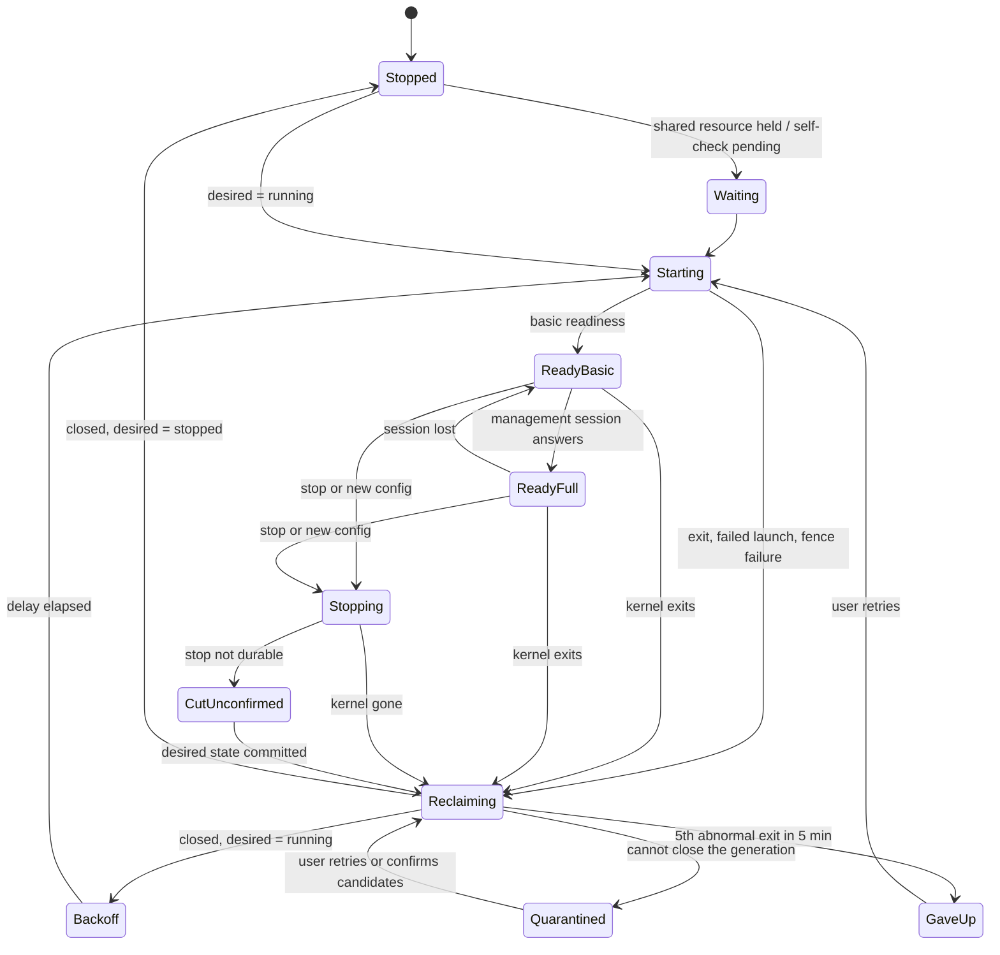

# Host

`etd-host` is the only process that starts kernels, writes the ledger and reclaims
system objects. This page covers its forms, how callers are authenticated, the state
machines it runs and how it protects the kernel's management port. The implementation
is split between `etd-host` (composition root, CLI, install) and `etd-host-core`
(orchestration and contract service); see their READMEs and
[`etd-host-core/docs/lifecycle.md`](../../crates/etd-host-core/docs/lifecycle.md).

## Host forms

| | System service | User host | Elevated session (planned) |
| --- | --- | --- | --- |
| Started by | SCM, systemd or launchd at boot; restarted after a crash | The UI, as a child process | The UI, through one UAC prompt |
| Identity | SYSTEM / root | Current user | Elevated administrator |
| TUN instances | Yes | No (SOCKS5, port forwarding only) | Yes |
| When the UI exits | Keeps running | Stops its instances and exits after a 30 s lease grace | Same as user host |
| After a crash | Service manager restarts it; self-check reclaims | The UI starts it again | The UI offers to clean up with another prompt |
| Status | Implemented | Implemented | Designed, Windows only |

`etd-host run --mode service|user` selects the form. A user host started from an
elevated token is refused; use the installed service instead.

### Locations

| | Windows | Linux | macOS |
| --- | --- | --- | --- |
| Service executable | `%ProgramFiles%\EasyTierDesk\etd-host.exe` | `/usr/local/lib/easytier-desk/etd-host` | `/Library/Application Support/easytier-desk/etd-host` |
| Service state and ledger | `%ProgramData%\EasyTierDesk\` | `/var/lib/easytier-desk/` | under `/Library/Application Support/easytier-desk/` |
| Service endpoint | named pipe, owner SYSTEM | socket under `/run/easytier-desk/` | `/Library/Application Support/easytier-desk/run/host.sock` |
| User host endpoint | `\\.\pipe\easytier-desk-user-<SID>` | `$XDG_RUNTIME_DIR/host.sock` (fallback `/tmp/easytier-desk-<uid>/`) | `easytier-desk/host.sock` under the per-user temporary directory |
| User host state | `%LOCALAPPDATA%\EasyTierDesk\` | `$XDG_STATE_HOME/easytier-desk/` | `~/Library/Application Support/easytier-desk/` |

`etd-host install` copies the executable to the protected location before registering
the service, records the allowed users, and on Unix creates the `easytier-desk` group.
Install is transactional and uninstall is staged and idempotent; maintenance commands
exclude each other through a maintenance lock. See the
[`etd-host` README](../../crates/etd-host/README.md).

## Authenticating a connection

There are no shared secrets or token files. Identity comes entirely from the
operating system.

1. **The endpoint limits who can connect.** The service pipe admits SYSTEM,
   Administrators and the user SIDs registered at install, grants read/write only (not
   permission changes), rejects remote clients and must be the first instance of its
   name. The Unix service socket lives in a root-owned directory with mode `0600` plus
   ACL entries for the allow-listed users and groups (by default the `easytier-desk`
   group). User host endpoints are private to their owner.
2. **The host checks the client.** For each connection the host reads the peer's
   credentials (Windows token SID and session, Unix uid) and maps them to a role
   through its allow list.
3. **The client checks the host.** Before sending anything, including secrets, the
   client verifies that the server process is the expected host: on Windows the pipe
   server's image lives in the protected install directory and the pipe is owned by
   SYSTEM; on Linux the peer is uid 0 behind a root-owned, non-writable path chain; for
   a user host the peer has the same uid and a private runtime directory. This stops an
   ordinary process from squatting on the endpoint name.
4. **Each method checks the role.** Every contract method declares a required role;
   the service checks it, together with the contract version metadata, on every call.

| Role | Can |
| --- | --- |
| Read | Status, peers, routes, logs, reclaim report |
| Control | Apply configuration, start and stop instances, retry cleanup |
| Admin | Change the allow list, manage kernels, purge all data; only for elevated callers (an elevated token on Windows, uid 0 on Unix) |

A user host accepts only its owner. It has no
allow list to change and offers no TUN.

## Instance lifecycle

Desired state has two values, *running* and *stopped*, stored with a revision in the
ledger. The UI changes only the desired state; the host keeps pulling the actual state
towards it. Every kernel exit, whatever its cause, goes through reclaim, and only after
that generation is closed does the host decide to restart or stay stopped.

- **Two readiness levels.** *Running* (basic readiness) means the process has lived long
  enough and an independent enumeration sees the expected adapter with an address, or
  the expected listening port for an instance without TUN. *Fully ready* means the
  management RPC answers and peer information was read back. An instance whose
  management port could not be fenced stays at basic readiness and the UI marks the
  management pages unavailable.
- **Generations.** Every launch of an instance is a new generation (epoch). A new
  generation may not start while the previous one has open records.
- **Gave up.** Backoff grows 1, 2, 4, 8 seconds; the fifth abnormal exit within five
  minutes stops automatic restarts. A start refused for a reason that will not go away
  (no trusted kernel, a rejected feature) also ends here. The desired state stays *running* until the user retries.
- **Quarantined.** Entered when reclaim fails five times in a row, when an object is
  present but its creation credential does not match (it becomes a candidate), or when
  the kernel process's liveness cannot be established. The UI lists the remaining
  objects for the user to retry or confirm one by one.
- **Cut off, unconfirmed.** If the ledger cannot be written during a stop, the host
  still kills the kernel, but the stop intent is not durable and a restart could bring
  the instance back. The UI shows this state with a "retry confirmation" action,
  distinct from *Stopped*.

The diagram is simplified (for example, a live instance can also be cut off directly);
the exact states and transitions are in
[`etd-host-core/docs/lifecycle.md`](../../crates/etd-host-core/docs/lifecycle.md).

## Host start-up self-check

The host has no special path for "the last run crashed". It runs the same self-check on
every start, before it accepts any control request:

1. Take the machine-wide singleton lock (the composition root does this). Only
   presence and log requests are served until the check ends.
2. Read the boot id and the desired state from the ledger. If the boot id changed,
   records that cannot survive a reboot are closed without probing; persistent ones are
   probed. A newer or unreadable ledger schema puts the host in diagnose-only mode
   (report, delete nothing); an otherwise unavailable ledger allows an orphan sweep and,
   only if every kernel found was killed, cleaning of exclusive containers. In both
   cases no instance starts.
3. Clean up orphan kernels: kill a recorded process only after verifying pid, start
   time and executable; then sweep for unrecorded kernels identified by "runs as the
   host, executable in the kernel store, command line points into the host's runtime
   directory".
4. Reclaim every open generation in reverse dependency order (DNS and firewall rules,
   registry values, adapters, runtime directories, process records). Objects found only
   by name become candidates.
5. Publish the reclaim report (part of the snapshot the UI receives), then start one
   supervisor per instance from the persisted desired state and replay pending
   tickets.

If reclaim fails for one instance, only that instance is quarantined; the others start
normally.

## Exit scenarios

| Scenario | Detected by | Kernel | Who reclaims, when | User sees |
| --- | --- | --- | --- | --- |
| Normal stop | User action | Graceful stop request (the kernel restores DNS and removes its interface rules), then kill tree on timeout | Host, right after the exit | Instance stopped |
| Kernel crash | Host supervisor (exit event) | Already dead | Host reclaims the old generation, then restarts with backoff | "Crashed, restarting" event |
| UI crash | Host (connection gone, lease expires) | Service: unaffected. User host: stopped after the lease grace | Only if the instance is stopped | UI reopens and restores from the snapshot |
| Host crash | Operating system | Killed with the host (job object, cgroup, process group) | Next host start, in the self-check | Brief outage; "host reconnecting" |
| Power loss | Next host start | Gone | Next host start; volatile records closed by boot id | Instances resume from desired state |

On Windows, ProcessKit's `CTRL_BREAK` does not reach a kernel when the parent is a
service or has no console. The host re-executes itself as `etd-host --console-ctrl
<pid>`, attaches to the kernel's hidden console and sends `CTRL_C` once; if that fails,
it kills the process tree. On Linux a user host's kernel gets a parent-death signal;
macOS has none, so the next start's orphan sweep covers it.

## The kernel's management port

EasyTier's management RPC is loopback TCP with no authentication and no switch to turn
it off, and its methods can create instances and change configuration. Without
protection, any local process could bypass the host's checks and drive a privileged
kernel. For each instance a privileged host therefore:

1. **Installs and records a fence:** a persistent system-level filter that admits local
   connections to that loopback port only from the host's identity (Windows WFP,
   Linux nftables matching the uid, macOS PF matching the user). It is a ledger record,
   so the port stays blocked if the host dies before the kernel.
2. **Starts the kernel and waits for it to listen,** then confirms the listener is the
   process it just started. No management capability is offered yet.
3. **Probes both ways on that endpoint:** the host's own connection must succeed, and a
   probe running with dropped privileges must be refused. A refusal only counts while
   the port has a listener. If either direction fails, the kernel is killed and
   reclaimed.
4. **Falls back** to the kernel's own allow list rejecting every source only if the
   adapter profile states that this configuration was verified for that kernel
   version; the instance then has lifecycle, logs and reclaim only. Otherwise the
   privileged instance does not start. No current profile marks deny-all as verified,
   so today an unverifiable fence means no privileged instance. Automatic restarts keep
   this verdict; an explicit stop, then start, or `etd-ctl start --retry`, tries a fresh
   fence.
5. **Removes the fence** only after the kernel is confirmed dead.

A user host's kernel runs as the user, gains nothing over the user's own rights, and is
not fenced. The long-term fix is an upstream management RPC over a named pipe or Unix
socket, which would make the fence unnecessary.

## Window and tray

Closing the window is not quitting. Quitting (tray or app menu, or the operating
system ending the session) follows one fixed order in `etd-app`'s exit gate: settle pending requests and give a session-form host its
lease back, stop subscriptions, stop the Tokio runtime, then quit GPUI, all within about
five seconds. The window and tray state table lives in `etd-app`, has no
GPUI dependency and is tested with a fake tray backend under out-of-order events. While
the host is unreachable, window and tray stay as they are and the UI shows "host
reconnecting".

## Elevated session (planned)

The elevated session form is designed but not implemented. Summary of the design:
Windows only; started with `run --mode elevated-session` through UAC (or directly when
the UI already runs elevated), only when no system service is registered and only for
administrator accounts; it takes the same machine locks as the service, so at most one
privileged host manages kernel objects at a time; its ledger lives per user under a
protected `%ProgramData%` directory whose owner and ACL are verified on every start; its
fence admits SYSTEM or elevated administrators and does not persist across reboots; it
exits when the UI releases its lease or after the lease grace. The contract already has
the `HOST_MODE_ELEVATED_SESSION` value.
