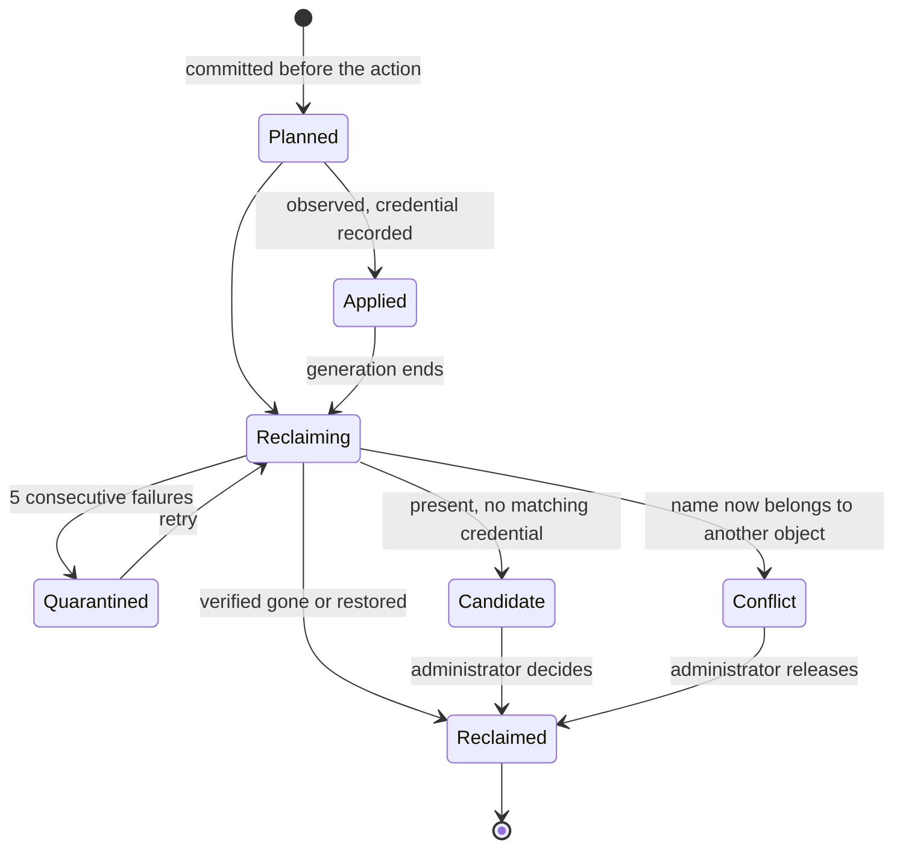

# Side effects: ledger and reclaim

Most of what an EasyTier kernel changes on a machine is created by the kernel itself;
the host cannot intercept it. What the host can do is predict it. Because the host
generates the configuration and forces the TUN name, nearly every object's identity can
be computed before the kernel starts. The host records those predictions in a ledger,
launches the kernel, and after any exit removes exactly what is provably ours.

Code: the model, ledger and reclaim engine are in [`etd-sysfx`](../../crates/etd-sysfx)
(details in [`docs/ledger-and-reclaim.md`](../../crates/etd-sysfx/docs/ledger-and-reclaim.md)),
the per-OS probes and removals in [`etd-sysfx-os`](../../crates/etd-sysfx-os)
([`docs/platforms.md`](../../crates/etd-sysfx-os/docs/platforms.md)), and the
prediction in [`etd-core-easytier`](../../crates/etd-core-easytier).

## What a kernel leaves behind

The adapter profile for the pinned upstream revision predicts these objects:

| Effect | Platform | How we recognise ours | After the kernel is killed | Host action |
| --- | --- | --- | --- | --- |
| Kernel process | All | pid + start time + executable; command line points into this generation's directory | n/a | Kill the tree after verifying identity |
| TUN adapter | Windows (wintun) | Name `etd-<8 hex>` derived from the install key and instance; GUID is the name's UUIDv5 | Expected to vanish | Verify by LUID that it is gone; it is never deleted: a lingering adapter is a candidate that keeps the generation open until it is gone |
| | Linux tun | Same derived name | Vanishes with the process | Re-check; delete through netlink if present |
| | macOS utun | Name assigned by the system, read back once ready | Vanishes with the process | Re-check |
| Addresses and routes | All | Attached to that adapter | Vanish with the adapter | Verify no route points at the interface |
| Interface firewall rules (8) | Windows | Rule names contain the adapter name | Remain | Remove by their eight exact names |
| Program firewall rules (2) | Windows | Rule names contain the kernel executable path | Upstream never removes them | Removed when that kernel binary leaves the store (per-binary scope) |
| Tcpip / Tcpip6 / NetBT values | Windows | Key path contains the adapter GUID | Not restored upstream | Remove once the adapter is confirmed gone |
| Magic DNS | Windows | Upstream's own recovery record under `HKLM\SOFTWARE\EasyTier\MagicDNS` | Remains until the next instance enables it | Replay upstream's recovery only when no other EasyTier process runs |
| | Linux | systemd-resolved per-link configuration | Not verified | Re-check, restore over D-Bus |
| | macOS | `/etc/resolver/` files | Upstream also deletes files it does not own | Not supported: Magic DNS system writes are disabled on macOS |
| Public IPv6 neighbour proxy | Linux | Only known at run time | Remains on the WAN interface | Not supported: a privileged host refuses the feature |
| Management-port fence | All | Created by the host in a product container: WFP provider and sublayer, nftables table, PF anchor | n/a (ours, not the kernel's) | Removed with the instance after the kernel is dead |
| Runtime directory | All | The host's `run/<instance>/<epoch>/`, holding the configuration with secrets | Remains | Delete the directory |
| UPnP / NAT-PMP mapping | Router | Upstream description | Expires after its lease | Recorded only |
| Drivers and service registration | All | wintun and WinDivert drivers; the host service | Persist | Product scope. The service is removed by uninstall; drivers are recorded and probed but not removed |

Configuration features are classified per platform by the adapter profile:
*supported* (effects computable before launch), *single writer* (machine-wide objects
such as Windows Magic DNS: one instance at a time), *disabled* on a platform where they
would destroy objects we do not own (macOS Magic DNS system writes), and *rejected* by a
privileged host when the write set is only known at run time or not yet modelled
(Linux public IPv6 provider). A kernel version without a profile cannot run in a
privileged host; a user host may run it in lifecycle-only mode (start, stop, logs, no
RPC), because there it cannot create privileged objects.

## The effect record

Each record carries:

- **Scope.** One generation of one instance (`instance + epoch`), one kernel binary
  (the Windows program firewall rules), or the product (drivers, service registration).
- **Kind and identity.** A concrete object kind (stable names such as `win.tun`,
  `win.firewall_rule`, `linux.resolved_link`) and a natural key that is enough to find
  the object with no in-memory state.
- **Undo.** *Ensure absent* for objects we (or the kernel for us) created; *restore if
  ours* for settings we changed (put back the original only if the current value is
  still ours); *replay upstream recovery* for Windows Magic DNS. All are idempotent.
- **Persistence.** *With process*, *until reboot*, *persistent*, or *expiring/lease*.
  After a reboot, records that cannot survive it are closed without probing.
- **Boot id** at write time, to tell whether the machine rebooted since.
- **State** and, once observed, the **creation credential** read back from the system.

Only *Reclaimed* is closed. A generation with any open record (including candidates and
conflicts) keeps its instance from starting the next generation.

## The ledger: record first, act second

The ledger is a SQLite database in the host's protected state directory
(`%ProgramData%\EasyTierDesk\` on Windows, `/var/lib/easytier-desk/` on Linux, the
`easytier-desk` directory under `/Library/Application Support/` on macOS), writable only
by administrators. One change commits, in a single transaction:

- the request record (request id, caller, canonical digest of the request);
- the desired state and its new revision;
- the operation ticket;
- every effect intent of the new generation.

All or nothing, so the ledger can only ever list more than exists, never less; extras
are found absent at probe time and closed. Retrying the same request id with the same
content returns the original receipt, the same id with different content is refused,
and a stale expected revision is a conflict. Secrets enter the request digest only as
an HMAC. The desired state exists only here: start-up restores instances from the
ledger and from nothing else.

The database runs in WAL mode with `synchronous=FULL` (plus `fullfsync` on macOS), on a
dedicated writer thread. Schema changes are versioned migrations
([`migrations/README.md`](../../crates/etd-sysfx/migrations/README.md)); an unknown,
newer schema is opened for diagnosis only.

If the ledger cannot be written (disk full, locked, corrupt), new starts are refused,
but cutting traffic never depends on a write: killing the kernel needs no new record,
the OS removes the adapter and routes with the process, and everything else stays in the
existing records until the ledger recovers. The UI then shows *cut off, unconfirmed*
rather than *stopped*.

## Ownership before deletion

A name only locates an object; deletion needs proof. Names and derived GUIDs are
visible, and someone else can recreate an object with the same name after ours is gone.
Before deleting, a reclaimer must match one of:

- the **creation credential** read back when the object appeared (Windows adapter LUID
  and device instance, Unix interface index plus boot id, a file's inode, a rule GUID or
  NRPT rule id); or
- an **exclusive container** only the host can write (the runtime directory, the WFP
  sublayer, the nftables table, the PF anchor).

A matching name with a different identity is a *conflict*: reported, never deleted.
A record still in *planned* state, with no credential read back yet, has no exception:
unless the object is in an exclusive container, it is only a *candidate*. To keep that
window short, the host starts enumerating as soon as it spawns the kernel and records a
credential the moment an object appears, without waiting for kernel readiness.

## Reclaim

The reclaim engine handles records by rank, in reverse dependency order: DNS and
firewall rules, registry values, adapters, runtime directories, and finally the process
record once the kernel is verified dead. For each record it probes; *absent* is
success; *present with a matching credential* is removed and probed again; anything
else becomes a candidate or conflict. Repeating a reclaim converges on the same result,
and a second run makes no system writes.

If the ledger is lost or corrupt, only a small repair index outside it remains (known
instances and the install key). It can re-derive names and find candidates; it can
neither start an instance nor authorise a deletion. In that state the host cleans only
exclusive containers and kernels that provably belong to it; everything else is listed
for an administrator to confirm item by item.

## Coexisting with official EasyTier

The firewall rule group and the Windows Magic DNS registry record are names shared with
upstream installations. Interface rules are told apart by the `etd-` adapter name.
Magic DNS cannot be told apart, so it is restored only when no other EasyTier process
is running. A running one proven to be outside our kernel store makes the record a
conflict: left in place, the holder named in the report, closed once the key is gone. A
process that cannot be proven either way is retried, then quarantined.

## Product-level effects

Drivers, the service registration and the per-binary program firewall rules are not
reclaimed with an instance. Removing a kernel binary from the store reclaims its
program rules first; `etd-host uninstall` removes the service registration, and
`etd-host reclaim --all --purge` covers product-scope records. The Windows driver
records (wintun, WinDivert) have no removal path yet: they are probed and reported, not
deleted.
